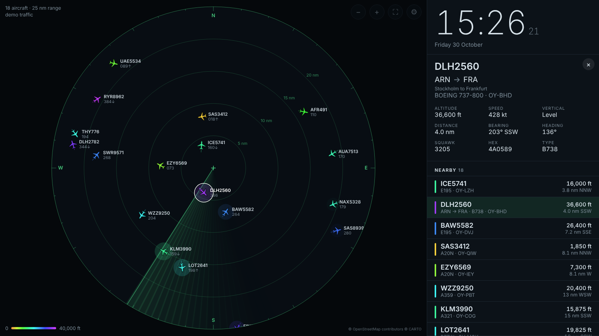

# Flightmon

A flight radar for a spare screen. It shows the aircraft overhead live on a
radar with a sweep, alongside a clock, the weather and a list of the nearest
flights. Tap a plane to see where it's going, what it is and a photo of it.

It's a web page, so anything with a browser can be the display: a second
monitor, an old iPad leaning against the bookshelf, a wall-mounted tablet.
It was inspired by [FlightScnr Pi](https://github.com/yashmulgaonkar/FlightScnr_Pi),
minus the Raspberry Pi and the round screen.



- **Radar** with range rings, a dark map underneath, a sweep that lights up
  blips as it passes, trails, and aircraft coloured by altitude. Positions are
  dead-reckoned between updates, so planes glide instead of jumping.
- **Nearby list**, closest first, with altitude, distance and direction.
- **Flight details**: route (from → to), aircraft type, registration,
  altitude, speed, climb/descent, squawk, and a photo from planespotters.net.
  The radar draws a dashed line toward the destination.
- **Emergencies** (squawk 7500/7600/7700) flash red.
- **Clock and weather**: current conditions, wind and sunrise/sunset.
- **Units**: aviation (ft, kt, nm), metric or imperial.
- Runs on **old iPads**: the page is plain ES5 JavaScript with no build step,
  and `npm test` checks that it stays that way. iOS 9 and later should work.
- **Demo traffic** so you can try it without any live data.

## Running it

You need [Node.js](https://nodejs.org) 18 or newer. There is nothing to install.

```sh
git clone https://github.com/Rassi/flightmon.git
cd flightmon
LAT=55.6761 LON=12.5683 npm start
```

Open <http://localhost:8080>. On another device on the same network (the
iPad), open `http://<that computer's name or IP>:8080`.

`LAT`/`LON` are just the default location for screens that haven't been set
up. Each screen can also set its own location in Settings (⚙), or in the
address: `http://mac-mini.local:8080/?lat=55.68&lon=12.57&radius=25&units=metric`.

### Settings via environment variables

| Variable     | Default                          | What it does                                                                                  |
|--------------|----------------------------------|-----------------------------------------------------------------------------------------------|
| `LAT`, `LON` | none                             | Default location for new screens                                                              |
| `RADIUS`     | `25`                             | Default range, in nautical miles                                                              |
| `UNITS`      | `aviation`                       | `aviation`, `metric` or `imperial`                                                            |
| `PORT`       | `8080`                           |                                                                                               |
| `PROVIDERS`  | `adsblol,airplaneslive,adsbfi`   | Which feeds to try, in order. If one is down the next is used                                 |
| `READSB_URL` | none                             | Use your own ADS-B receiver instead, e.g. `http://raspberrypi.local/tar1090/data/aircraft.json` |

### Settings in the address bar

Anything in Settings can go in the URL. That's the easiest way to set up an
iPad without typing on it: `lat`, `lon`, `radius` (nm), `units`, `basemap`
(`dark`/`none`), `refresh` (seconds), `sweep`, `labels`, `trails`, `clock24`
and `demo` (each `1`/`0`).

### Keyboard (for the monitor)

`+` / `-` changes the range, `f` goes full screen, `s` opens Settings, `Esc`
deselects.

## Setting up an old iPad

1. Open the address in Safari, then *Share → Add to Home Screen*. Launched
   from there it runs full screen, without the Safari toolbars.
2. *Settings → Display & Brightness → Auto-Lock → Never*, so the screen stays on.
3. Optionally, use *Guided Access* (*Settings → General → Accessibility*) to
   lock the iPad to Flightmon.

The page reloads itself at 04:00 every night, so a screen left on for weeks
stays fresh.

"Use my location" only works when the page is served over https or from
`localhost`. That's a browser rule. On the iPad, type the coordinates, or
put them in the address.

## Keeping it running

On a Mac or Linux box that's always on, a process manager keeps the server up:

```sh
npx pm2 start server.js --name flightmon && npx pm2 save
```

On Linux, a systemd unit works just as well. Point `ExecStart` at
`node /path/to/flightmon/server.js` and put `LAT`/`LON` in `Environment=`.

## How it works

`server.js` is a small Node server with no dependencies. It serves the page
in `public/` and proxies three lookups that a browser can't make directly:

| Endpoint        | Upstream                                                                                          | Cached   |
|-----------------|---------------------------------------------------------------------------------------------------|----------|
| `/api/aircraft` | [adsb.lol](https://adsb.lol), then [airplanes.live](https://airplanes.live), then [adsb.fi](https://adsb.fi), or your own receiver | 2.5 s    |
| `/api/route`    | adsb.lol's route database                                                                         | 1 hour   |
| `/api/photo`    | [planespotters.net](https://www.planespotters.net)                                               | 24 hours |

The cache is shared, so several screens pointed at one server cost the
upstream feeds one request between them. `lib/data.js` turns each provider's
answer into the small shape the page draws from.

The page (`public/app.js`) polls `/api/aircraft` every few seconds and draws
on a canvas. Map tiles (CARTO Dark) and the weather
([Open-Meteo](https://open-meteo.com)) are fetched directly by the browser,
since both allow that. If the page is opened without a server behind it, it
falls back to demo traffic.

Route data is crowd-sourced and sometimes stale; the detail panel says so
when adsb.lol flags a route as implausible.

## Development

```sh
npm install   # only for the ES5 check
npm test      # unit tests for the data shaping and the server, plus the ES5 check
```

`public/app.js` must stay ES5: no `let`/`const`, arrow functions, template
strings, `fetch`, `Object.assign` and so on. That's what keeps it working on
old iPads.

## Credits

Aircraft positions come from adsb.lol (ODbL), airplanes.live and adsb.fi,
whose data is fed by volunteers' receivers. Photos are from planespotters.net
and credited to their photographers. Map tiles are © OpenStreetMap
contributors © CARTO. Weather is from Open-Meteo.
